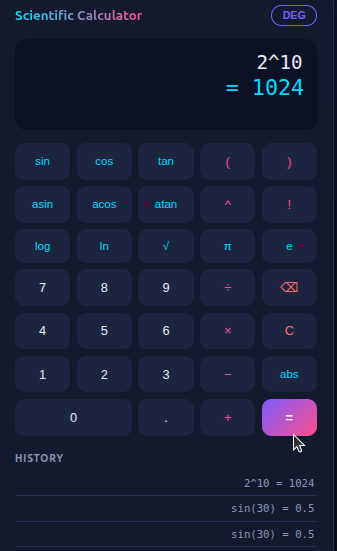

# Scientific Calculator

A scientific calculator for the web and the command line, built with Python and Flask.

**Live demo:** https://scientific-calculator-taeg.onrender.com

> Hosted on a free plan, so the first visit after a quiet period can take up to a minute to wake up.

<p align="center">
  
</p>

## Features

- Web interface with an on-screen keypad, keyboard input, and a history of recent calculations
- Basic arithmetic, powers (`^`), and parentheses
- Trigonometric and inverse trigonometric functions with a degree/radian toggle
- Logarithms: `log()` (base 10) and `ln()`
- `sqrt()`, `abs()`, factorial (`!`), and the constants `pi` and `e`
- A safe expression parser written from scratch, with no use of `eval()`
- Clear error messages for invalid input, division by zero, and domain errors
- A command-line version with history and angle-mode commands
- Automated tests with pytest

## How It Works

1. A tokenizer splits the expression into numbers, names, operators, and parentheses.
2. A recursive descent parser evaluates the tokens, with one method per precedence level.
3. A Flask endpoint, `POST /calculate`, takes JSON and returns a result or an error.
4. The web page sends expressions to that endpoint and shows the response.

## Run the Web Version Locally

```bash
git clone https://github.com/mosochife/scientific_calculator.git
cd scientific_calculator
python3 -m venv venv
source venv/bin/activate
pip install -r requirements.txt
python app.py
```

Then open http://127.0.0.1:5000 in your browser.

## Run the Command-Line Version

```bash
python main.py
```

| Command | Description |
|---|---|
| `help` | Display available commands |
| `history` | Show successful calculations |
| `clear` | Clear the current session's history |
| `deg` | Switch to degree mode |
| `rad` | Switch to radian mode |
| `quit` | Exit the calculator |

## Examples

```text
2+3*4        ->  14
sin(30)      ->  0.5     (degree mode)
sin(pi/2)    ->  1       (radian mode)
sqrt(25)     ->  5
5!           ->  120
-2^2         ->  -4
```

## Running the Tests

```bash
pip install -r requirements-dev.txt
python -m pytest -v
```

The tests cover the calculator engine, the command-line interface, and the web API.

## Project Files

```text
scientific_calculator/
├── calculator.py        # Tokenizer, parser, and evaluator
├── app.py               # Flask web app and API
├── main.py              # Command-line interface
├── templates/
│   └── index.html       # Web page
├── static/
│   ├── style.css        # Styling
│   └── script.js        # Browser logic
├── test_calculator.py   # Engine tests
├── test_cli.py          # Command-line tests
├── test_app.py          # Web API tests
├── requirements.txt     # Runtime dependencies
└── requirements-dev.txt # Test dependencies
```

## Deployment

Deployed on Render with `pip install -r requirements.txt` as the build command and `gunicorn app:app` as the start command.

## What I Learned

- **Why not `eval()`:** it runs any Python code, so it is unsafe on a public website. Writing a tokenizer and a recursive descent parser keeps the calculator limited to the math it supports.
- **Operator precedence comes from structure:** one parser method per precedence level is what makes `-2^2` equal `-4` and `2^3^2` equal `512`.
- **Floating-point noise:** computers store decimals in binary, so `sin(30)` came out as `0.49999999999999994`. Rounding the result in the API fixes the display, and the tests compare values with a tolerance.
- **Tests first, then the web layer:** the engine had passing tests before I built the Flask API and page, so I could trust it.
- **Deployment:** I moved from `python app.py` to `gunicorn` and deployed on Render, where I learned to separate runtime and dev requirements.

## Author

**mosochife** - [github.com/mosochife](https://github.com/mosochife)
